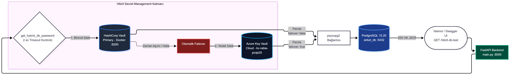

Hibrit Secret Management Mimarisi (HashiCorp Vault + Azure Key Vault)

Bu proje, uygulama kaynak kodu içerisine gömülü parolaları (Hardcoded Secrets) ortadan kaldırmak ve yüksek erişilebilirlik (High Availability) sağlamak amacıyla geliştirilmiş Hibrit Çoklu Kasa (Hybrid Multi-Vault) mimarisini uygular.

FastAPI tabanlı arka uç servisi, yerel PostgreSQL (sirket_db) veritabanı parolasını çalışma zamanında dinamik olarak çeker:

Birincil Kaynak (Primary): Düşük gecikmeli yerel erişim için Docker üzerinde çalışan HashiCorp Vault (http://127.0.0.1:8200) kullanılır.

İkincil Kaynak (Secondary / Cloud Fallback): Birincil kasa erişilemez olduğunda (ağ hatası, konteyner durması veya zaman aşımı) sistem kesinti yaşamadan otomatik olarak buluttaki Azure Key Vault (kv-rabia-proje25) kasasına geçiş yapar.

Kullanılan Teknolojiler

Backend Framework: Python 3.14, FastAPI, Uvicorn

Birincil Gizli Anahtar Kasası: HashiCorp Vault (Docker Konteyner — KV v2 Engine, hvac SDK)

Yedek Gizli Anahtar Kasası: Azure Key Vault (Switzerland North — azure-keyvault-secrets, azure-identity)

Veritabanı: PostgreSQL 15.20 (Docker Konteyner, psycopg2-binary)

Ön Gereksinimler

Python 3.10+

Docker Desktop (proje25-postgres ve proje25-vault konteynerleri)

Azure CLI (az login ile aktif oturum)

Kurulum ve Çalıştırma Adımları

1. Bağımlılıkların Yüklenmesi

Proje dizininde gerekli Python kütüphanelerini kurun:

pip install fastapi uvicorn psycopg2-binary azure-keyvault-secrets azure-identity hvac

2. Azure Oturumunun Doğrulanması

Uygulamanın DefaultAzureCredential üzerinden Azure Key Vault'a erişebilmesi için terminalde Azure oturumu açın:

az login

3. Yerel HashiCorp Vault Gizli Anahtarının Tanımlanması

Geliştirici (dev) modunda çalışan HashiCorp Vault konteyneri yeniden başlatıldığında RAM üzerindeki kayıtlar sıfırlanır. Test öncesinde parolayı yerel kasaya yazın:

docker exec -e VAULT_ADDR="http://127.0.0.1:8200" -e VAULT_TOKEN="root-token-demo" proje25-vault vault kv put secret/veritabani DB_PASSWORD="AdminMasterPassword123!"

4. FastAPI Sunucusunun Başlatılması

uvicorn main:app --reload

Sunucu ayağa kalktıktan sonra tarayıcıdan http://127.0.0.1:8000/docs adresine giderek Swagger UI arayüzüne erişebilirsiniz.

API Uç Noktaları ve Failover Test Senaryoları

GET /: Aktif birincil (HashiCorp Vault) ve ikincil (Azure Key Vault) kasa yapılandırma özetini döner.

GET /hibrit-db-test: Hibrit kasa yöneticisinden parolayı çekerek PostgreSQL veritabanına canlı bağlantı kurar ve hangi kasanın kullanıldığını raporlar.

Canlı Failover Test Adımları

Test A (Normal Çalışma): proje25-vault konteyneri açıkken /hibrit-db-test isteği gönderilir. Yanıtta "aktif_secret_kaynagi": "HashiCorp Vault (Primary - Self-Hosted)" ve "failover_durumu": false döner.

Test B (Felaket Kurtarma / Failover): docker stop proje25-vault komutu ile birincil kasa durdurulur ve tekrar istek gönderilir. Uygulama 2 saniyelik zaman aşımı sonrası buluta geçerek "aktif_secret_kaynagi": "Azure Key Vault (Secondary - Cloud Fallback)" ve "failover_durumu": true yanıtıyla veritabanı bağlantısını kesintisiz sürdürür.

## Sistem Mimarisi

📄 **Detaylı Proje Raporu (PDF):** [Kapsamlı Proje Raporunu Görüntüle / İndir](hibrit_secret_management_kapsamli_rapor.docx)